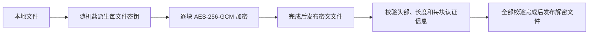

# HidePhotoCrypto

仅包含通用 AES-256-GCM 内存消息加解密及大文件分块处理的独立 Swift Package。

**许可证：PolyForm Noncommercial License 1.0.0。仅允许非商业使用，商业使用必须获得版权所有者的书面授权。** 许可范围及例外以完整 [LICENSE](LICENSE) 为准。

版权所有者：**YueGe**，`Copyright (c) 2026 YueGe`。商业授权请通过本仓库的 **[GitHub Issues](https://github.com/bensgo/HidePhotoCrypto/issues)** 联系版权所有者；未经书面授权不得商业使用。请勿在公开 Issue 中提交私人联系方式、真实密钥或用户数据。

## 安装与验证

要求 Swift 6+，支持 macOS 13+、iOS 17+。在 Xcode 中添加 [GitHub 仓库](https://github.com/bensgo/HidePhotoCrypto)，选择 `HidePhotoCrypto` 产品；也可使用本地 Package。

```sh
python3 scripts/audit_publication.py
swift package dump-package
swift build -c release
swift test
```

不需要启动模拟器；测试在 macOS 上执行。

## 内存消息

```swift
import Foundation
import HidePhotoCrypto

let key = EncryptionKey.generate()
let input = Data("synthetic example bytes".utf8)
let context = Data("example context v1".utf8)
let encrypted = try Encryption.encrypt(input, using: key, authenticating: context)
let decrypted = try Encryption.decrypt(encrypted, using: key, authenticating: context)
assert(decrypted == input)
```

每次加密随机生成 12 字节 nonce，返回 CryptoKit 的标准 combined 数据：`nonce || ciphertext || tag`。解密必须传入相同密钥及 context；错误密钥、密文篡改或 context 不匹配均拒绝解密。context 参与认证，但不加密，也不嵌入密文。

密钥只在运行时生成。调用方负责安全保存密钥；`exportBytes()` 仅供调用方写入自己的安全存储，重新载入时使用 `EncryptionKey(bytes:)`。不要记录密钥、把密钥放进源代码、随密文保存或提交到 Git。库不提供 PIN、密码验证、密钥恢复或业务会话管理。

## 大文件

```swift
let inputURL = URL(fileURLWithPath: "/your/local/input.bin")
let encryptedURL = URL(fileURLWithPath: "/your/local/encrypted.hpc")
let outputURL = URL(fileURLWithPath: "/your/local/restored.bin")

try FileEncryption.encrypt(from: inputURL, to: encryptedURL, using: key)
try FileEncryption.decrypt(from: encryptedURL, to: outputURL, using: key)
```

默认每块 1 MiB，可在加密时设置 `chunkSize`（1 字节至 16 MiB）。操作同步执行，应放到合适的后台执行上下文，避免阻塞 UI。



文件格式为本包独立的 **HPC1**，详见 [格式说明](docs/FORMAT.md)。这不是现有 App 或 Obscura 文件格式的替换方案，也不声称兼容其保险箱、数据库和备份。本包未修改或接入任何现有 App 的加解密流程及文件格式。

文件 API 只接受本地文件 URL。源文件保留，目标存在时拒绝覆盖。先在同目录私有临时目录处理，全部完成后移动到目标；普通错误或任务取消时尝试清理临时输出。iOS 临时目录及输出启用完整文件保护。

分块头、总长度和块索引参与认证；空文件也包含一个认证块，避免空文件跳过密钥验证。错误密钥、头部篡改、截断、附加字节或块重排均拒绝输出完成文件。

## 公开范围

- 只包含通用密钥类型、内存和文件加解密、合成数据测试、文档及发布检查脚本。
- 不包含 Hide Photos 业务逻辑、PIN 验证、伪装保险箱、真实密钥、用户媒体、凭据、生产配置或 App 工程。
- 没有第三方 Swift Package 依赖，仅链接 Apple 的 CryptoKit、Foundation；不打包其实现。来源及许可证检查见 [依赖说明](docs/DEPENDENCIES.md)。
- 不包含 ObscuraCrypto 的 GPL 源码、测试样本或文档副本。其 README 仅作为最初功能范围的参考。

测试覆盖内存及文件往返、随机性、密钥重建、错误密钥、数据和 context 篡改、空文件、块边界、32 MiB 大文件、头部修改、截断、重排、失败清理和目标不覆盖。测试数据全部临时合成。

## 安全边界

- 没有网络请求、遥测、账号、权限申请或密钥持久化。
- 请在处理期间保持输入文件不变；检测文件长度变化不等同于对并发写入建立完整快照。
- 成功解密的文件是明文，调用方负责访问控制和生命周期。已返回的 `Data` 也由调用方管理，本包不承诺所有框架内存副本都能清零。
- 崩溃或强制终止可能遗留 `.hpc-*` 临时目录，调用方应在自身受控输出目录中清理残留。删除文件不保证物理介质安全擦除。
- HPC1 不隐藏文件长度，也不防止攻击者以另一份完整合法文件进行替换或回滚。应用如需文件身份绑定，应在独立的可信元数据中验证。
- 尚未经过独立安全审计。不要将其描述为已经验证了任何已发布 App 的二进制或存储格式。

## 发布状态

发布仓库为 [bensgo/HidePhotoCrypto](https://github.com/bensgo/HidePhotoCrypto)。用户已确认版权署名、商业授权联系渠道，并授权创建全新公开仓库及推送。该仓库仅以本目录文件创建初始提交，不携带 App 或旧仓库的 Git 历史。详见 [发布检查说明](docs/RELEASE_REVIEW.md)。
